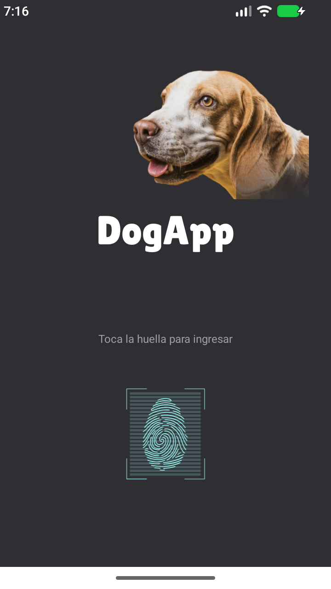
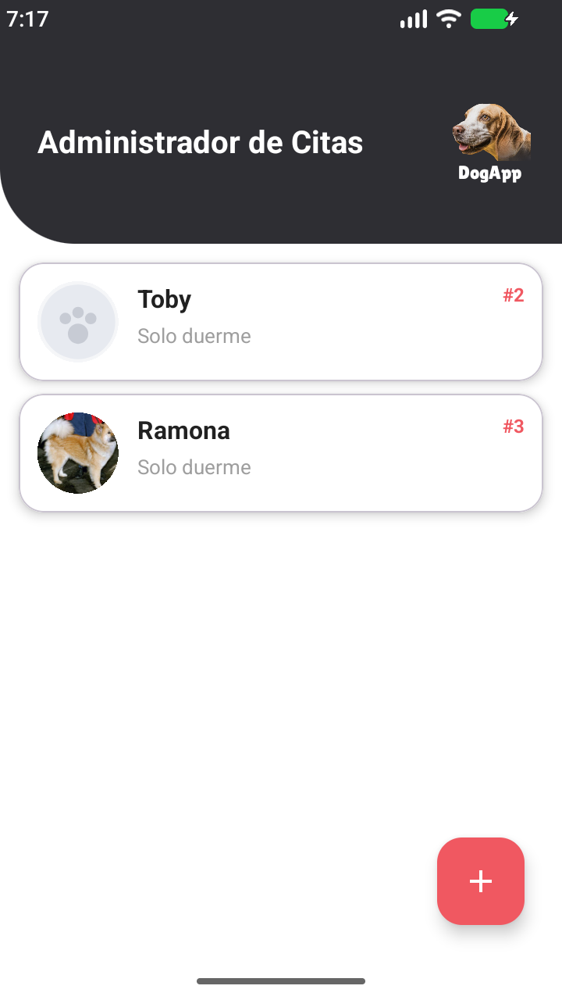
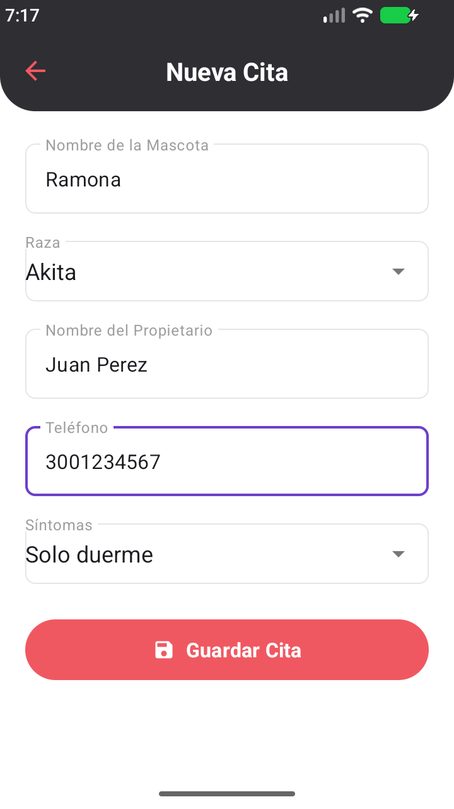
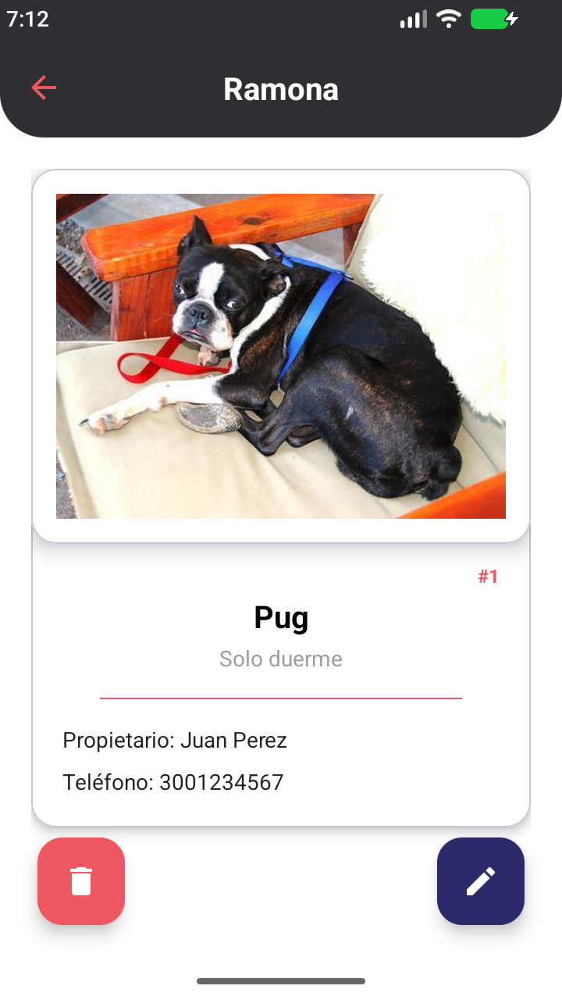
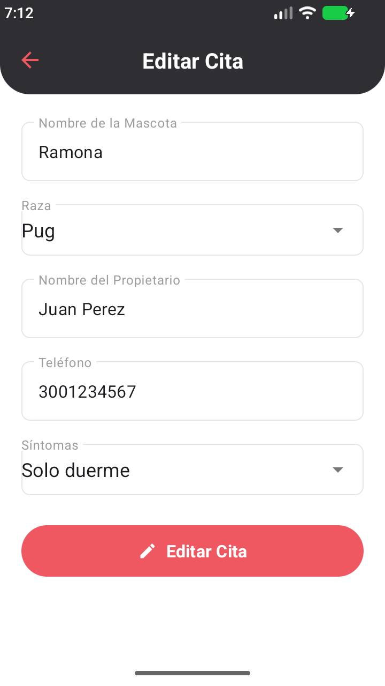
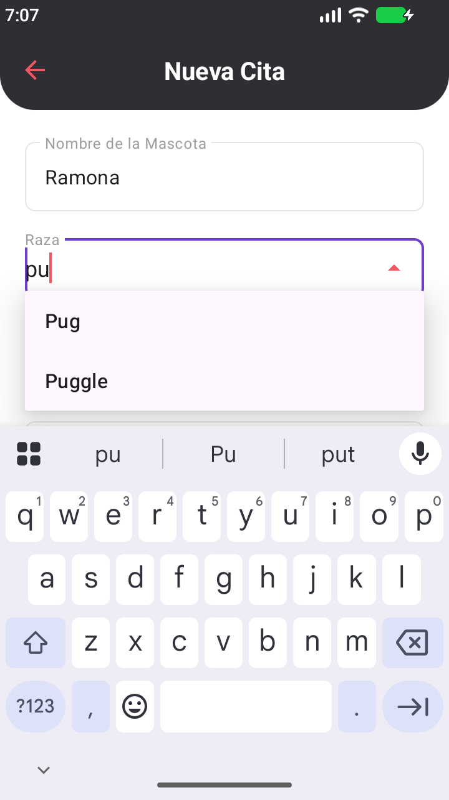

# DogApp — Agenda de citas para mascotas

Miniproyecto 1 · Sprint 1 · Desarrollo de Aplicaciones para Dispositivos Móviles
Universidad del Valle — Escuela de Ingeniería de Sistemas y Computación

Aplicación Android nativa (Kotlin) para que el administrador de una veterinaria
registre y gestione las citas de las mascotas que debe atender.

- **Tablero Jira:** [Proyecto DOG · DogApp](https://hernanchho.atlassian.net/jira/software/projects/DOG/boards/1/backlog)
- **Repositorio:** https://github.com/DogApp-Univalle/DogApp

## Integrantes

- _Medina Hernán Cod. 2369271_
- _Santos Sebastian Cod. 2160870_
- _Trujillo Nicolas Cod. 2360268_
- _Chicaiza Andres Cod. 2560684_
- _Agudelo Juan Cod. 2360154_

## Estado del Sprint 1

Las cinco historias están implementadas y **verificadas en emulador** (API 37): recorrido
completo login biométrico → Home → Nueva cita → Detalle → Editar → Eliminar, más la
prueba en modo avión.

| Ítem de la rúbrica (RA-1) | Dónde se evidencia |
|---|---|
| Arquitectura MVVM con Repository | paquetes `model`, `view`, `viewmodel`, `repository`, `data` |
| Funcionamiento según las HU | las 5 pantallas y sus criterios |
| SQLite con Room | `data/local` (`CitaEntity`, `CitaDao`, `DogAppDatabase`) |
| Consumo de API REST | `data/remote` (Retrofit + `dog.ceo`) |
| Uso de Fragments | `view/login`, `home`, `nueva`, `detalle`, `editar` |
| Uso de Navigation | `res/navigation/nav_graph.xml` con 5 destinos y `citaId` |

En Jira el sprint está cargado: épica `DogApp - Sprint 1` (`DOG-1`) con las historias
`DOG-2` … `DOG-6`, 28 puntos en total, y el tablero con las columnas
**Por hacer / En curso / En revisión / Hecho**.

## Pantallas (una sola Activity + cinco Fragments)

| HU | Pantalla | Fragment |
|----|----------|----------|
| 1.0 | Login con biometría | `LoginFragment` |
| 2.0 | Home administrador de citas | `HomeFragment` |
| 3.0 | Nueva cita | `NuevaCitaFragment` |
| 4.0 | Detalle de la cita | `DetalleFragment` |
| 5.0 | Editar cita | `EditarFragment` |

## Reparto por historia

| Historia | Responsable | Rama |
|---|---|---|
| HU 1.0 Ventana Login | Santos Sebastián | `feature/hu1-login` |
| HU 2.0 Home Administrador de Citas | Medina Hernán | `feature/hu2-home` |
| HU 3.0 Ventana Nueva Cita | Trujillo Nicolás | `feature/hu3-nueva` |
| HU 4.0 Ventana Detalle de la Cita | Chicaiza Andrés | `feature/hu4-detalle` |
| HU 5.0 Ventana Editar Cita | Agudelo Juan | `feature/hu5-editar` |

Cada historia se trabaja en su rama y entra a `develop` por Pull Request revisado por
otro integrante.

## Capturas

| Login (biometría) | Home | Nueva cita |
|---|---|---|
|  |  |  |

| Detalle | Editar cita | Autocompletado |
|---|---|---|
|  |  |  |

## Arquitectura MVVM + Repository

```
com.univalle.dogapp
├── data/
│   ├── local/     CitaEntity · CitaDao · DogAppDatabase   (Room / SQLite)
│   └── remote/    DogApiService · BreedsResponse · ImageResponse · RetrofitClient
├── repository/    CitaRepository
├── model/         Cita
├── viewmodel/     LoginViewModel · HomeViewModel · FormCitaViewModel · DetalleViewModel
├── view/          MainActivity · login/ · home/ · nueva/ · detalle/ · editar/ · form/
├── di/            ServiceLocator (inyección sin frameworks)
└── utils/         Constants · BiometricHelper
```

Reglas que se respetan:

- Ningún Fragment toca Room ni Retrofit: todo pasa por el ViewModel y el Repository.
- Ningún ViewModel recibe `Context`.
- Toda la UI se actualiza observando `LiveData`; las operaciones de datos son `suspend`.
- `observarTodas()` del DAO devuelve `LiveData<List<CitaEntity>>`, por eso el Home se
  refresca solo al insertar, editar o eliminar.

## Tecnologías

Kotlin · MVVM + Repository · Room 2.6.1 (KSP) · Retrofit 2.9 + Gson ·
Navigation 2.7.6 · Glide 4.16 · Lottie 6.3 · androidx.biometric 1.1 ·
ViewBinding · Corrutinas.

## Cómo compilar

```bash
# Requiere JDK 17 y el Android SDK con el platform 34
./gradlew assembleDebug
```

Abrir el proyecto en Android Studio y ejecutar en un dispositivo o emulador con
**huella enrolada**. En el emulador, con el diálogo biométrico abierto:

```bash
adb -e emu finger touch 1
```

## API REST consumida

| Uso | Endpoint |
|-----|----------|
| Lista de razas (autocompletado) | `https://dog.ceo/api/breeds/list/all` |
| Foto de una raza concreta | `https://dog.ceo/api/breed/{raza}/images/random` |
| Respaldo (raza no encontrada o sin red) | `https://dog.ceo/api/breeds/image/random` |

### Decisión técnica sobre la foto de la raza

El enunciado pide que la imagen corresponda a la raza elegida ("si la raza fue Akita,
la imagen debe mostrar un Akita"). Por eso:

1. Se usa `/breed/{raza}/images/random` para cumplir el requisito funcional.
2. Se deja `/breeds/image/random` como respaldo cuando la raza no existe en la API.
3. Si no hay red, la cita se guarda igual y la vista muestra un marcador local.

## Persistencia

Room con la tabla `citas`: `id` (turno `#n`, autogenerado), `nombreMascota`,
`raza`, `propietario`, `telefono` (String, para no perder ceros), `sintoma`,
`imagenUrl` y `fechaCreacion`.

## Flujo de ramas

```
main                    ← lo entregable, se congela el 25 de noviembre
└── develop             ← integración del sprint (aquí se trabaja)
    ├── feature/hu1-login
    ├── feature/hu2-home
    ├── feature/hu3-nueva
    ├── feature/hu4-detalle
    └── feature/hu5-editar
```

Cada historia se trabaja en su rama y se integra con un **Pull Request hacia `develop`**
revisado por otro integrante. No se commitea directamente en `main`.

## Estructura del repositorio

| Ruta | Contenido |
|---|---|
| `app/` | Código fuente Android (Kotlin + XML) |
| `documentacion/HU_miniproyectoDogApp_Pro1.pdf` | Enunciado oficial del miniproyecto |
| `documentacion/DogApp-Sprint1/` | Especificación técnica de construcción |
| `documentacion/capturas/` | Capturas de las 5 pantallas |
| `documentacion/Images/` | Recursos de origen (Lottie, imágenes) |

## Gestión del proyecto

- **Jira:** [tablero DOG](https://hernanchho.atlassian.net/jira/software/projects/DOG/boards/1/backlog) —
  épica, 5 historias con criterios y sprint con fechas.
- **Repositorio:** https://github.com/DogApp-Univalle/DogApp
- **Ramas:** `develop` como integración y una `feature/hu*` por historia.
